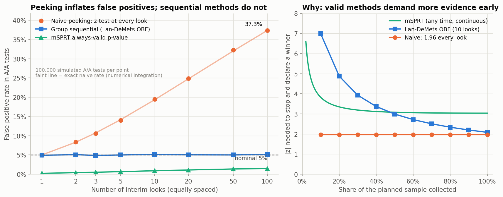
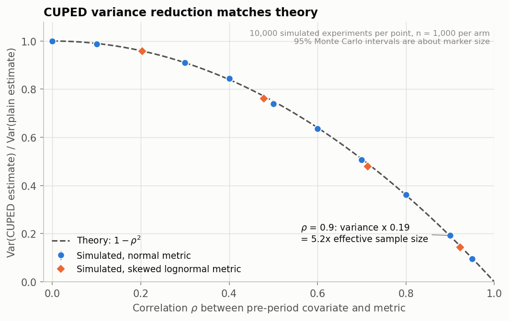
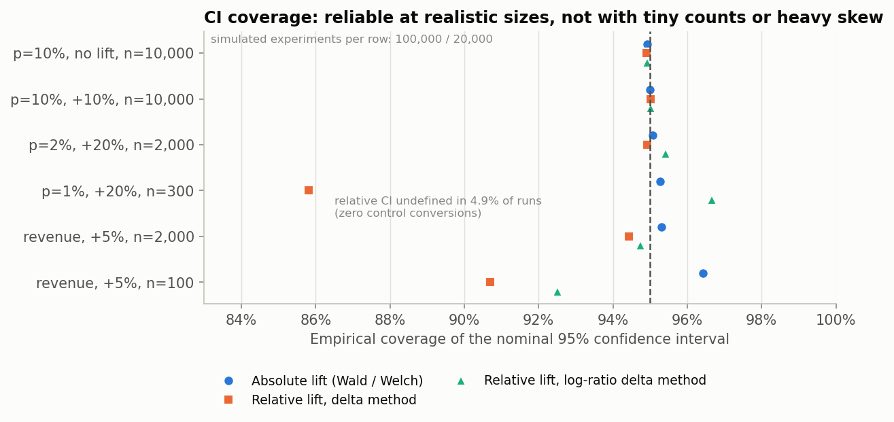
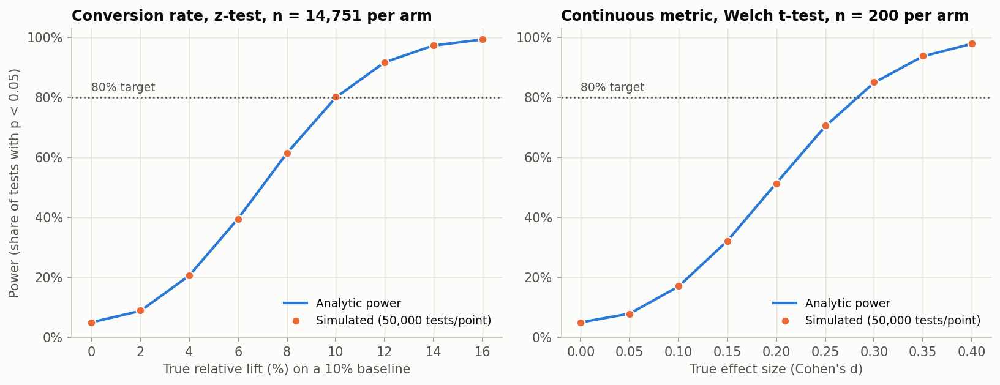

# A/B Testing Toolkit (`abkit`)

A rigorous A/B-test analysis library and CLI whose statistical guarantees are **verified by
simulation**, not just implemented.

[](https://github.com/faiqrasulov/ab-testing-toolkit/actions/workflows/ci.yml)

[](LICENSE)

## Key results

All numbers come from `make run` (seeded Monte Carlo, under 40 s on a laptop CPU) and are stored
in [`reports/metrics.json`](reports/metrics.json).

| What was checked | Result |
|---|---|
| Naive "peeking" (z-test at every look, A/A data) | False-positive rate **19.5%** with 10 looks and **37.3%** with 100 looks (nominal 5%); matches the exact value from numerical integration (19.3%, 37.4%) |
| Group-sequential test (Lan-DeMets O'Brien-Fleming), 1-100 looks | False-positive rate **4.90%-5.12%** across all look schedules (100,000 A/A tests each) |
| mSPRT always-valid p-values, checked 1,000 times per test | False-positive rate **1.77%** (valid, conservative), but only **53.7%** power at the same maximum sample vs 80.0% for the fixed test |
| CUPED variance reduction vs theory `1 - rho^2` | Matches across 15 settings (max abs z = 2.03); rho = 0.9 cuts variance to **0.193x** (theory 0.190), i.e. **5.2x** effective sample size |
| Analytic power vs simulation | Max abs gap **0.19 pp** (conversion z-test) and **0.26 pp** (Welch t-test); Monte Carlo SE is 0.22 pp |
| Underpowered tests | At ~21% power (true lift +4%), significant "wins" overstate the true lift by **2.2x** on average |



## Problem & why it matters

Product teams ship features, prices and ranking changes on the strength of A/B tests, and
the result usually gets compressed into "p < 0.05, ship it". Three failure modes do most of
the damage in practice:

1. **Peeking.** Dashboards update continuously and people stop the test the first time it
   looks significant. With 10 looks a 5% test produces false positives about 19% of the time.
2. **Sample ratio mismatch (SRM).** A redirect, bot filter or logging bug drops users from one
   arm. The groups are no longer comparable, and the "lift" can be entirely an artefact.
3. **Underpowered tests.** Small samples mostly return "not significant"; when they do return
   a winner, the estimate is badly inflated, so the shipped feature underdelivers.

`abkit` puts the standard defences against all three into one small, tested library and
then checks, by simulation with known ground truth, that each method delivers the error
rate it promises.

## Approach

Everything is implemented from scratch on numpy/scipy. statsmodels is used **only in the
tests**, as an independent reference.

| Module | What it does | Key design decision |
|---|---|---|
| `power.py` | Power, sample size and MDE for two proportions and two means | Power includes both rejection tails, so power and sample size are exact inverses; proportions use the pooled-null/unpooled-alternative normal approximation (matches statsmodels), means use the noncentral t |
| `frequentist.py` | Two-proportion z-test, Welch t-test, CIs for absolute and relative lift | Fully vectorised: the same function analyses one experiment in the CLI and 100,000 simulated ones in the studies. Relative lift CI by the delta method on the ratio, plus a log-ratio variant |
| `srm.py` | Chi-square goodness-of-fit SRM check | p < 0.001 threshold (industry convention) and a dedicated `SampleRatioMismatchWarning` |
| `cuped.py` | CUPED (Deng et al. 2013) | theta estimated once on both arms pooled, so both arms get the same adjustment; the estimate stays unbiased because the covariate is measured before randomisation. Works on batches of experiments |
| `bayesian.py` | Beta-Binomial posterior, P(B > A), expected loss, credible interval of lift | P(B > A) by 1-D quadrature (accurate to ~1e-10), Monte Carlo with a fixed seed for the loss and lift interval |
| `sequential.py` | Lan-DeMets alpha-spending boundaries and mSPRT always-valid p-values | Boundaries solved look by look with the Armitage-McPherson-Rowe recursion on a Simpson grid; the same code gives exact type-I error, power and expected sample size for any boundary |
| `simulation.py`, `studies.py` | Monte Carlo validation | Conversions drawn as binomial counts per look (exactly equivalent to simulating users, far cheaper); each study has its own seed |
| `cli.py`, `report.py` | `abkit analyze` and `abkit sample-size` | Report leads with the SRM check and ends with decision guidance that refuses to call a winner when SRM is present |

**Why two sequential methods.** Group-sequential boundaries (O'Brien-Fleming-type spending)
fit teams that can commit to a schedule of looks; they keep nearly all of the fixed test's
power. The mixture SPRT (Johari et al. 2017) allows looking after every user, at the cost of
power at any fixed maximum sample. The simulations quantify that trade-off instead of asserting it.

**Correctness checks** (80 tests, about 3 s): power and sample size vs `statsmodels.stats.power`
and `power_proportions_2indep`; z-test, Wald and log-ratio CIs vs statsmodels; Welch vs scipy
and statsmodels; OBF boundaries vs the published 5-look table (4.877, 3.357, 2.680, 2.290,
2.031); naive peeking vs Armitage, McPherson & Rowe (1969); the mSPRT likelihood ratio vs
direct numerical integration of the mixture; P(B > A) vs the closed form for integer
posteriors; CUPED vs an ANCOVA regression; and CLI and pipeline smoke tests.

## Results

All data in this section are **simulated**, because only simulation provides known ground truth:
the true effect is fixed, so false-positive rates, coverage and power can be measured directly.

Reproducibility: with fixed library versions `make run` is byte-for-byte deterministic. The
committed numbers were produced with numpy 1.26 and scipy 1.13 (versions recorded in
`metrics.json` and pinned in [`requirements.lock`](requirements.lock)). numpy 2.x draws binomial variates from a different random stream, so a fresh
install reproduces every conclusion but not the last Monte Carlo digits; a check under numpy
2.5 / scipy 1.18 differed only within Monte Carlo error.

### (a) Peeking vs valid sequential tests

A/A tests (both arms convert at 10%), maximum 14,751 users per arm (the fixed-horizon sample
size for 80% power at a +10% relative lift), looks equally spaced; 100,000 simulated tests per
row (Monte Carlo SE about 0.07 pp at 5%).

| Looks | Naive peeking (simulated) | Naive peeking (exact) | Lan-DeMets OBF | mSPRT | Final OBF boundary |
|---:|---:|---:|---:|---:|---:|
| 1 | 4.93% | 5.00% | 4.93% | 0.22% | 1.960 |
| 2 | 8.36% | 8.31% | 5.06% | 0.41% | 1.969 |
| 3 | 10.62% | 10.73% | 4.90% | 0.51% | 1.993 |
| 5 | 14.00% | 14.17% | 5.00% | 0.66% | 2.031 |
| 10 | 19.47% | 19.34% | 5.12% | 0.89% | 2.081 |
| 20 | 24.89% | 24.79% | 5.03% | 1.10% | 2.123 |
| 50 | 32.29% | 32.05% | 5.00% | 1.35% | 2.164 |
| 100 | 37.33% | 37.36% | 5.11% | 1.48% | 2.185 |

The cost and benefit of each strategy on the same simulated paths (50,000 tests each; under H1
the treatment converts at 11%):

| Strategy | False-positive rate (A/A) | Power (+10% lift) | Avg. share of max sample used under H1 |
|---|---:|---:|---:|
| Fixed horizon (1 look) | 4.96% | 80.0% | 100.0% |
| Naive peeking, 10 looks | 19.54% | 86.7% | 50.1% |
| Lan-DeMets OBF, 10 looks | 5.01% | 78.4% | 77.4% |
| mSPRT, 1,000 looks | 1.77% | 53.7% | 77.3% |

Interpretation:
- The O'Brien-Fleming design is the practical winner for planned looks: it gives up 1.6 pp of
  power and, under the alternative, stops at 77% of the maximum sample on average. The
  recursion predicts 78.5% power and 77.3% average sample, matching the simulation.
- The naive "power" of 86.7% is not a benefit; it comes from a 19.5% false-positive rate.
- **What did not work as well:** the mSPRT is valid but conservative (1.77% vs 5%), and at the
  same maximum sample its power is only 53.7%. Its z-threshold settles near 3.0 rather than
  1.96 (right panel of the figure above). It earns its keep when the horizon is open-ended,
  not when the sample size is fixed.

### (b) CUPED variance reduction

Each point is 10,000 simulated experiments with 1,000 users per arm and a true effect of 0.1;
"lognormal" uses skewed, revenue-like data built from a Gaussian copula, with the exact
Pearson rho computed analytically.



| Data | rho | Var ratio (simulated) | Theory 1 - rho^2 | z | Effective sample size | CI coverage |
|---|---:|---:|---:|---:|---:|---:|
| normal | 0.30 | 0.911 | 0.910 | +0.2 | 1.10x | 95.4% |
| normal | 0.50 | 0.740 | 0.750 | -1.4 | 1.35x | 95.0% |
| normal | 0.70 | 0.507 | 0.510 | -0.4 | 1.97x | 95.6% |
| normal | 0.90 | 0.193 | 0.190 | +0.7 | 5.19x | 94.9% |
| lognormal | 0.48 | 0.761 | 0.771 | -1.3 | 1.31x | 95.2% |
| lognormal | 0.71 | 0.479 | 0.491 | -1.8 | 2.09x | 95.1% |
| lognormal | 0.92 | 0.143 | 0.148 | -2.0 | 6.99x | 94.9% |

(Full 15-row table in `metrics.json`.) The adjusted estimator stays unbiased (|bias| <= 0.0006
against an effect of 0.1) and its CI keeps 94.8%-95.6% coverage. On skewed lognormal data the
simulated ratio runs 1-4% *below* theory (z between -1.3 and -2.0); this is within noise
individually but consistent in sign, so treat `1 - rho^2` as a slightly conservative planning
number for heavy-tailed metrics.

### (c) Confidence-interval coverage



| Scenario | Reps | Absolute (Wald / Welch) | Relative, delta | Relative, log-ratio | Relative CI undefined |
|---|---:|---:|---:|---:|---:|
| p=10%, no lift, n=10,000 | 100,000 | 94.9% | 94.9% | 94.9% | 0.0% |
| p=10%, +10%, n=10,000 | 100,000 | 95.0% | 95.0% | 95.0% | 0.0% |
| p=2%, +20%, n=2,000 | 100,000 | 95.1% | 94.9% | 95.4% | 0.0% |
| p=1%, +20%, n=300 | 100,000 | 95.3% | 85.8% | 96.7% | 4.9% |
| revenue, +5%, n=2,000 | 20,000 | 95.3% | 94.4% | 94.7% | 0.0% |
| revenue, +5%, n=100 | 20,000 | 96.4% | 90.7% | 92.5% | 0.0% |

At realistic sample sizes every interval is within 0.6 pp of nominal. The **delta-method
relative CI breaks down with tiny counts** (85.8% coverage when the control expects 3
conversions, and undefined in 4.9% of runs) and with heavy skew at n = 100 (90.7%). The
log-ratio interval is better in both cases, which is why `abkit` ships it as an option.
Revenue uses lognormal data with sigma = 1.5 (skewness about 33).

### (d) Power: analytic vs simulated



50,000 simulated tests per point. Empirical power never differs from the analytic curve by
more than 0.19 pp (z-test) or 0.26 pp (Welch t-test), against a Monte Carlo SE of 0.22 pp.
The same simulation measures how much a significant result exaggerates the truth when power
is low (Gelman & Carlin's type-M error), at n = 14,751 per arm and a 10% baseline:

| True relative lift | Power | Significant wins overstate the lift by | Significant results with the wrong sign |
|---:|---:|---:|---:|
| +2% | 9.0% | 4.25x | 7.2% |
| +4% | 20.7% | 2.22x | 0.5% |
| +6% | 39.4% | 1.58x | 0.0% |
| +10% | 80.2% | 1.12x | 0.0% |

Users per arm needed for 80% power at alpha = 0.05 on a 10% baseline:
+1% relative: 1,419,069; +2%: 356,334; +5%: 57,763; +10%: 14,751; +20%: 3,841.

### The CLI on a simulated experiment

`examples/simulated_ab_test.csv` is **simulated**: 8,000 existing customers, and treatment
truly raises expected orders by 8%. Abridged output of the command run by `make run`:

```text
$ abkit analyze examples/simulated_ab_test.csv --group variant --metric revenue --pre-metric pre_revenue

OK: No evidence of SRM: observed shares [49.55%, 50.45%] (chi2 = 0.65, p = 0.421 >= 0.001).

## 2. Result (fixed-horizon test)
| Absolute lift (B - A)     | +1.67  | 95% CI [-0.08921, +3.429] |
| Relative lift (B / A - 1) | +7.78% | 95% CI [-0.72%, +16.29%] (delta method) |
| p-value (Welch t-test)    | 0.0628 | alpha = 0.05 |

## 3. CUPED adjustment (pre-experiment covariate `pre_revenue`)
theta = 0.561, corr(pre, metric) = 0.545, variance of the lift estimate reduced by 29.7%
(equivalent to 1.42x the sample size).
| Absolute lift (B - A)     | +1.514 | 95% CI [+0.03922, +2.989] |
| Relative lift (B / A - 1) | +7.03% | 95% CI [-0.05%, +14.11%] (delta method) |
| p-value (Welch t-test)    | 0.0442 | alpha = 0.05 |

## 4. Bayesian view
- P(B > A) = 97.8%
## 5. Power check
With n = 3,964 / 4,036, the minimum detectable effect at 80% power is +2.515 (+11.7% relative);
with CUPED about +2.109 (+9.8% relative).

## Decision guidance
- Treatment wins. Lift +1.514 (+7.03%), p = 0.0442. P(B > A) = 97.8%; ...
```

CUPED turns an inconclusive result into a significant one, without more users, and the
estimate (+7.0%) is close to the true +8%. Note that the absolute CI excludes zero while the
relative CI just touches it: the relative interval also carries the uncertainty of the
control mean in its denominator, so the two can disagree near the boundary. The Bayesian line
adds no information for a revenue metric: it is a flat-prior normal approximation, so P(B > A)
is 1 - p/2 of the Welch test (97.8% = 1 - 0.0442/2).

`examples/simulated_ab_test_srm.csv` has **no true effect**, but a simulated logging bug loses
25% of treatment users who never ordered. A naive read shows +15.5% conversion (p < 0.0001);
`abkit` flags the SRM (52.66% / 47.34%, p = 4.3e-06) and the decision guidance says
**"Do not make a decision yet."**

## Quickstart

```bash
git clone https://github.com/faiqrasulov/ab-testing-toolkit.git
cd ab-testing-toolkit
make install          # pip install -e ".[dev]"
make run              # simulation studies -> reports/metrics.json + figures, then the CLI demo
make test             # 80 tests, ~3 s
```

`make install` takes the newest compatible packages. To reproduce the committed `reports/`, use
`make install-locked` instead: it installs the versions pinned in
[`requirements.lock`](requirements.lock) (Python 3.12), with which `make run` regenerates every
value in `reports/metrics.json` exactly (checked on macOS arm64).

```bash
abkit analyze my_experiment.csv --group variant --metric converted
abkit analyze my_experiment.csv --group variant --metric revenue --pre-metric pre_revenue
abkit sample-size --baseline 0.10 --relative-mde 0.05
```

```python
from abkit import group_sequential_boundaries, two_proportion_ztest, srm_check

srm_check([5300, 4700])                          # warns: sample ratio mismatch
two_proportion_ztest(1000, 10_000, 1100, 10_000)  # lift, CIs (absolute + relative), p-value
group_sequential_boundaries(5).boundaries         # [4.877, 3.357, 2.680, 2.290, 2.031]
```

## Project structure

```
src/abkit/
  power.py         sample size, power, MDE
  frequentist.py   z-test, Welch t-test, absolute and relative lift CIs
  srm.py           sample ratio mismatch check
  cuped.py         CUPED variance reduction
  bayesian.py      Beta-Binomial and normal-approximation Bayesian summaries
  sequential.py    Lan-DeMets boundaries, crossing probabilities, mSPRT
  simulation.py    vectorised Monte Carlo building blocks
  studies.py       the four validation studies -> reports/metrics.json
  figures.py       report figures
  report.py, cli.py  `abkit analyze` / `abkit sample-size`
examples/          simulated example CSVs + the script that generates them
reports/           metrics.json and figures written by `make run`
tests/             80 pytest tests (references: statsmodels, scipy, published tables)
```

## Limitations & next steps

- **Two arms only.** Multi-arm tests need a multiplicity correction (Holm or Dunnett), not yet
  implemented.
- **Sequential methods are library-level only.** The CLI analyses a final snapshot; it does not
  yet take a timestamp column to replay looks. The mSPRT uses a normal approximation with a
  plug-in variance, and its mixing scale `tau` must be chosen up front (here: the design MDE).
- **The SRM check is a detector, not a guarantee.** A small loss of users can bias the lift
  while staying below the p < 0.001 alarm (try `DROP_RATE = 0.15` in the example generator).
  A clean SRM check is necessary, not sufficient.
- **Independence assumed.** Users are the randomisation and analysis unit. Ratio metrics
  (e.g. revenue per session) and cluster randomisation need delta-method variances at the
  cluster level.
- **Next steps:** always-valid confidence sequences next to the mSPRT p-values, a futility
  boundary for the group-sequential design, a binding/non-binding option, and multi-arm support.

## Data & references

No external dataset is used. All data are simulated with fixed seeds (see
`examples/make_example_data.py` and `src/abkit/studies.py`) because the goal is to verify
statistical guarantees, which requires known ground truth.

- Deng, Xu, Kohavi & Walker (2013). *Improving the sensitivity of online controlled experiments
  by utilizing pre-experiment data.* WSDM. (CUPED)
- Johari, Koomen, Pekelis & Walsh (2017). *Peeking at A/B tests: why it matters, and what to do
  about it.* KDD. (mSPRT, always-valid p-values)
- Lan & DeMets (1983). *Discrete sequential boundaries for clinical trials.* Biometrika 70(3).
- O'Brien & Fleming (1979). *A multiple testing procedure for clinical trials.* Biometrics 35(3).
- Armitage, McPherson & Rowe (1969). *Repeated significance tests on accumulating data.* JRSS A.
- Jennison & Turnbull (2000). *Group Sequential Methods with Applications to Clinical Trials.*
  Chapman & Hall/CRC.
- Robbins (1970). *Statistical methods related to the law of the iterated logarithm.* Ann. Math. Stat.
- Fabijan et al. (2019). *Diagnosing sample ratio mismatch in online controlled experiments.* KDD.
- Gelman & Carlin (2014). *Beyond power calculations: assessing type S and type M errors.*
  Perspectives on Psychological Science.
- Kohavi, Tang & Xu (2020). *Trustworthy Online Controlled Experiments.* Cambridge University Press.

## License

MIT, see [LICENSE](LICENSE).
